# TMEAS E-Commerce: Parallel & Distributed Order System on AWS

A cloud prototype of a **real-time sales order management system** for a large-scale e-commerce platform, built on Amazon Web Services. It shows how parallel request handling, load balancing, caching and a separate analytics pipeline keep an online store responsive and consistent during peak sales traffic such as 11.11 or Black Friday.

> **Course:** WQD7008 Parallel and Distributed Computing, Semester 1 2025/2026, Universiti Malaya (OCC 1, Group 17)
> **Assignment:** Group Assignment 2: Implementing the Distributed Architecture in AWS

---

## Table of Contents

1. [Highlights](#highlights)
2. [System Architecture](#system-architecture)
3. [How It Works (System Flows)](#how-it-works-system-flows)
4. [Repository Structure](#repository-structure)
5. [Deployment Guide](#deployment-guide)
6. [Testing](#testing)
7. [Performance Results](#performance-results)
8. [Limitations & Future Work](#limitations--future-work)
9. [License](#license)

---

## Highlights

| | |
|---|---|
| **Parallelism** | ALB spreads traffic over 2 EC2 instances in 2 Availability Zones; each runs Gunicorn with 3 worker processes |
| **Consistency** | Stock is decremented with an **atomic Redis `DECR`**, so concurrent buyers can't oversell; orders are persisted in MySQL (RDS) |
| **Speed** | Cache-aside reads from ElastiCache (Redis) keep load off the transactional database |
| **Security** | CloudFront + WAF (rate limit 300 req / 5 min per IP), Cognito login enforced at the ALB, data tier in private subnets |
| **Analytics** | RDS → Glue ETL → S3 (Parquet) → Athena → QuickSight, kept fully separate from live traffic |
| **Tested** | Locust stress test with **500 concurrent users**, monitored via CloudWatch |

---

## System Architecture

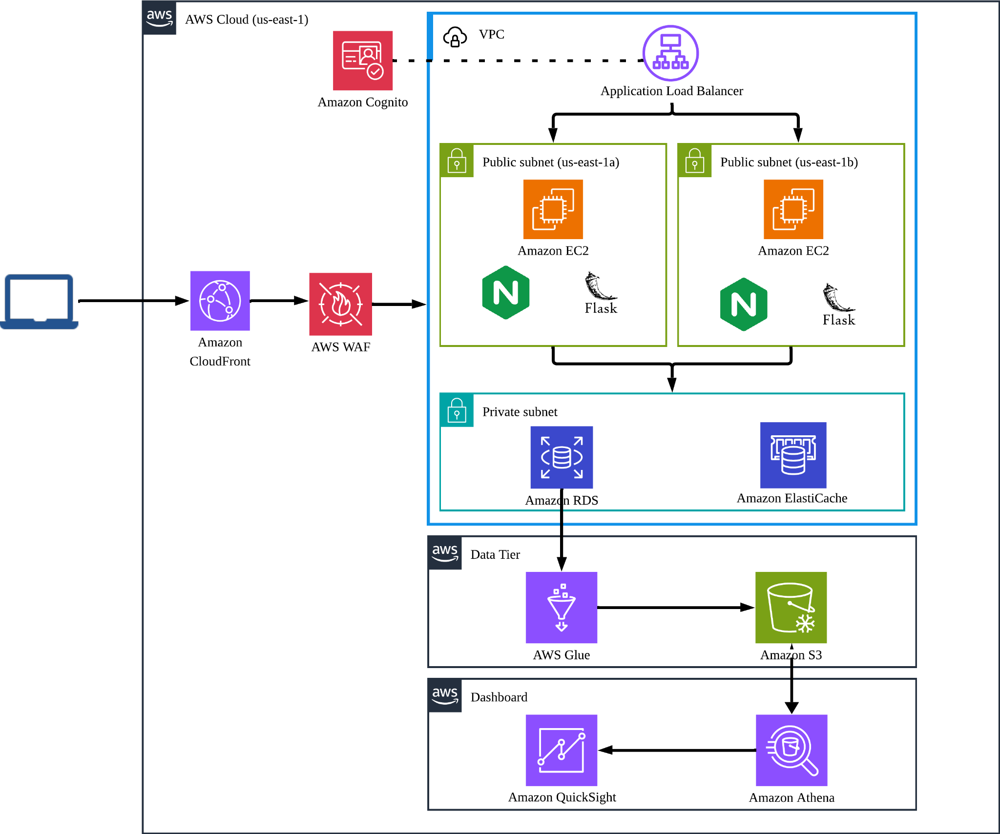

The system is deployed in **us-east-1 (N. Virginia)** and organised into five layers:

| Layer | AWS services | Role |
|---|---|---|
| Client access & edge security | CloudFront, WAF, Cognito | CDN edge routing, threat protection and rate limiting, user authentication |
| Networking & load balancing | VPC (2 AZs), Application Load Balancer | Isolation, fault tolerance, single HTTPS entry point that spreads requests across instances |
| Application compute | EC2 (Ubuntu 24.04, t3.micro) ×2 | Flask app served by Gunicorn behind an Nginx reverse proxy |
| Data storage | ElastiCache (Redis OSS), RDS (MySQL) | In-memory live stock cache plus the persistent orders/products store, both in private subnets |
| Analytics | Glue, S3, Athena, QuickSight | ETL to a data lake, serverless SQL, dashboards |

**Request path:** `User → CloudFront → WAF → ALB (Cognito auth) → EC2 (Nginx → Gunicorn → Flask) → ElastiCache / RDS`

---

## How It Works (System Flows)

### Flow 1: Authentication (Cognito)
The ALB listener has an **"Authenticate user"** pre-routing action backed by a Cognito User Pool (OIDC). Unauthenticated users are redirected to the Cognito hosted sign-in page. After login, the ALB sets an `AWSELBAuthSessionCookie` and forwards the user's claims to the app in the `X-Amzn-Oidc-Data` header, which `app.py` decodes and stores in the Flask session.

### Flow 2: Product browsing (ElastiCache + RDS, read path)
`GET /` loads products from RDS and uses a **cache-aside** pattern for live stock: if `stock:<id>` is missing in Redis, it is seeded from MySQL with `SETNX` (so concurrent requests can't overwrite each other); otherwise the cached value is displayed.

### Flow 3: Order creation (Redis + RDS, write path)

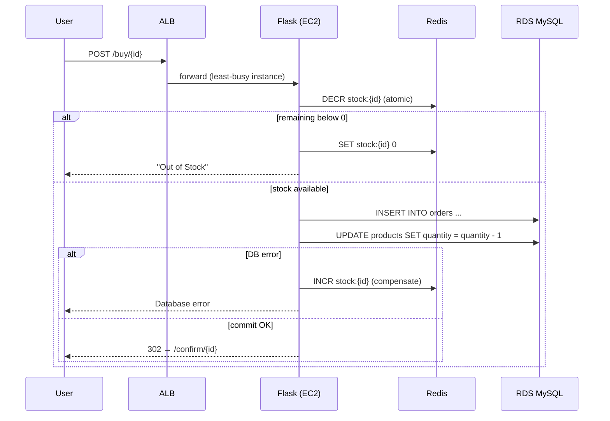

Because Redis executes `DECR` atomically on a single thread, two buyers racing for the last item on **different EC2 instances** can never both succeed. That is how the system prevents overselling without distributed locks.

### Flow 4: Analytics (S3 → Athena → QuickSight)
A Glue crawler catalogs the RDS `ecommerce` database, and a Glue ETL job copies it to S3 as **Parquet (Snappy)**. Athena queries the data lake with standard SQL and QuickSight visualises it, so heavy reporting never touches the live database.

---

## Repository Structure

```
.
├── app.py                         # Flask app: auth, product listing, buy, confirm
├── dbsetup.py                     # Creates `ecommerce` DB + tables, flushes Redis (destructive!)
├── insertProducts.py              # Seeds 4 sample products (qty 10 each)
├── templates/
│   ├── index.html                 # Shop page (shows which server handled the request)
│   └── confirm.html               # Order confirmation page
├── configurationfileforsetup/
│   ├── tmeas_website_nginx.backup # Nginx reverse proxy → 127.0.0.1:8000
│   ├── tmeas.service.backup       # systemd unit: Gunicorn, 3 workers, Restart=always
│   └── nginx_default.backup       # Original Nginx default site (reference)
├── pyproject.toml / uv.lock       # Python deps managed with uv
└── docs/images/                   # Screenshots used in this README
```

### Data model (MySQL `ecommerce`)

| Table | Columns |
|---|---|
| `products` | `id` PK, `name`, `description`, `price`, `category`, `quantity`, `image_url` |
| `orders` | `id` PK, `user_email`, `product_id` FK → products, `status`, `created_at` |

Redis keys: `stock:<product_id>` holds the live stock counter.

### App routes

| Route | Method | Description |
|---|---|---|
| `/` | GET | Product list with live stock from Redis |
| `/login` | GET | Redirects to Cognito hosted UI |
| `/authorize` | GET | OIDC callback, stores user in session |
| `/logout` | GET | Clears session and logs out of Cognito |
| `/buy/<id>` | POST | Atomic stock decrement + order insert |
| `/confirm/<id>` | GET | Order confirmation page |

---

## Deployment Guide

> All services were set up in the AWS Console at minimum sizes to fit Learner Lab / free-tier limits. Each step shows the configuration used and the successful result.

### 1. Networking & Security

<details>
<summary><b>1.1 VPC</b>: 2 AZs, public + private subnets</summary>

- Region `us-east-1`, AZs `us-east-1a` and `us-east-1b`, each with one public and one private subnet.
- NAT Gateway **disabled** to save cost, so EC2 instances live in public subnets with auto-assigned public IPs.

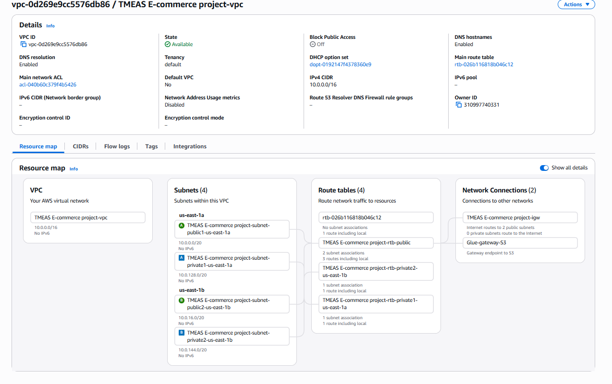
</details>

<details>
<summary><b>1.2 CloudFront + WAF</b></summary>

- Origin: the Application Load Balancer.
- WAF (free plan) protects against common web threats and DDoS, with a rate limit of **300 requests per 5 minutes per IP**.

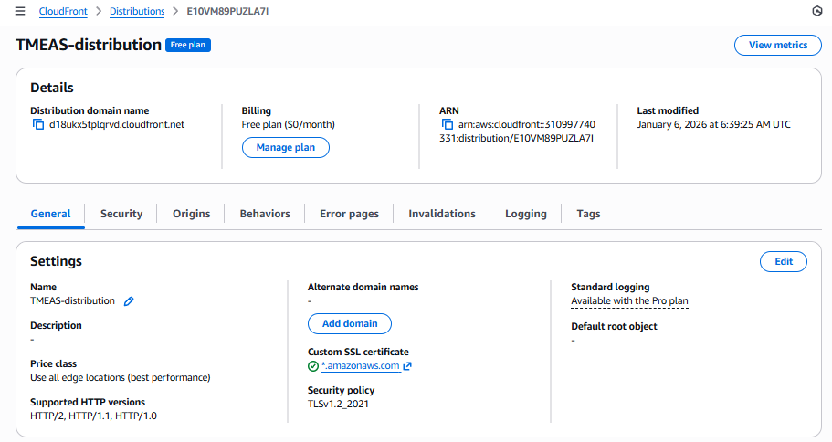
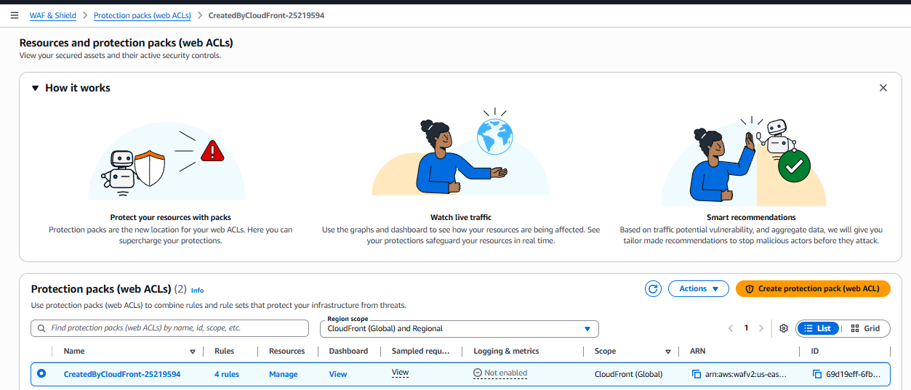
</details>

<details>
<summary><b>1.3 Target Group + Application Load Balancer</b></summary>

- Target group: type **Instances**, protocol **HTTP:80**, register both EC2 instances. Health checks stop traffic to unhealthy targets.
- ALB: internet-facing, **HTTPS listener**, pre-routing action **Authenticate user (Cognito)**, then forward to the target group.

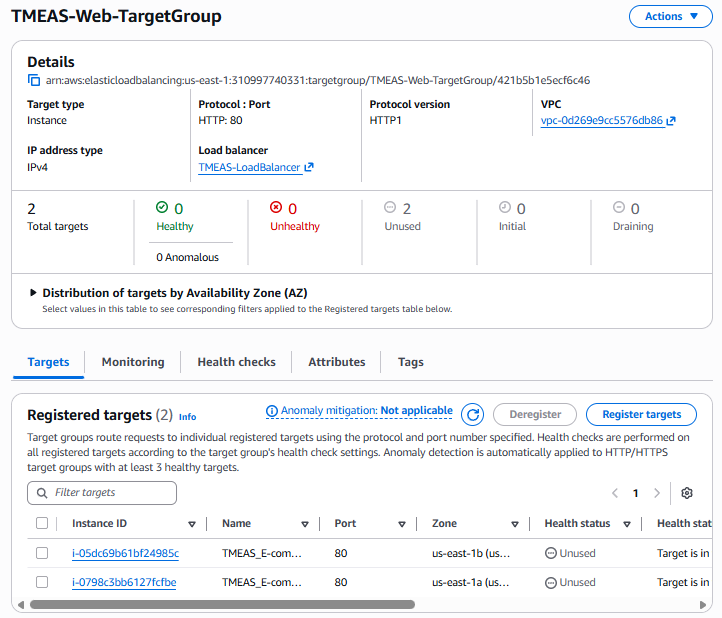
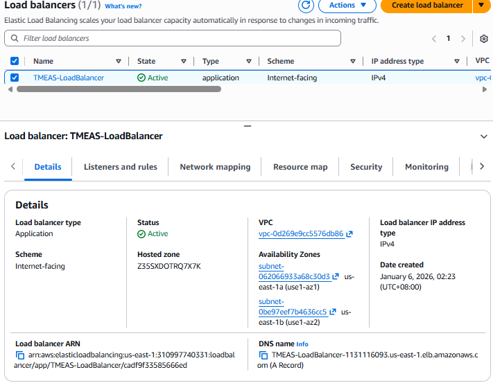
</details>

<details>
<summary><b>1.4 Security Group</b></summary>

One shared security group (kept open for demo simplicity):

| Inbound | Port |
|---|---|
| HTTPS | 443 |
| HTTP | 80 |
| SSH | 22 |
| MySQL/Aurora | 3306 |
| Redis (ElastiCache) | 6379 |
| Custom TCP (Glue, Gunicorn) | 0–65535 |

Outbound: all traffic.

> ⚠️ For anything beyond a demo, scope these rules down (e.g. only the ALB SG can reach EC2:80, only the EC2 SG can reach 3306/6379).

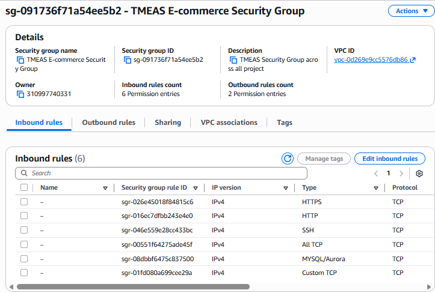
</details>

### 2. Authentication: Amazon Cognito

- Create a User Pool, choose **Traditional web application**, enable self-registration, sign in with email + username.
- In the app client's **Login pages**, add callback URLs:
  - `https://<ALB-DNS>/oauth2/idpresponse` (used by the ALB auth action)
  - `https://<ALB-DNS>/authorize` (used by Flask to read user info)

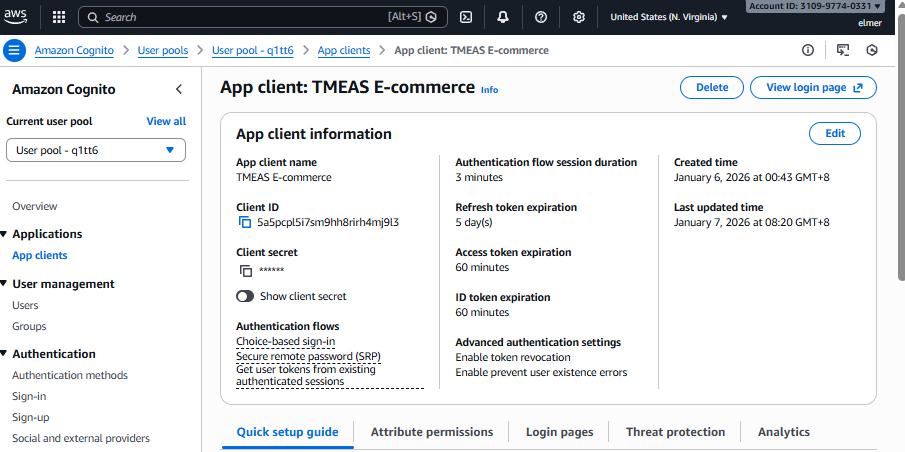
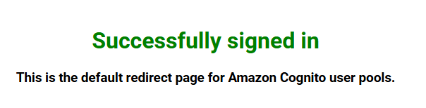

### 3. Data Storage

<details>
<summary><b>3.1 ElastiCache (Redis OSS)</b></summary>

Node-based cluster, cluster mode disabled (single node), `cache.t3.small`, existing VPC with subnets in `us-east-1a` and `us-east-1b`, encryption in transit enabled (the app connects with `ssl=True`).

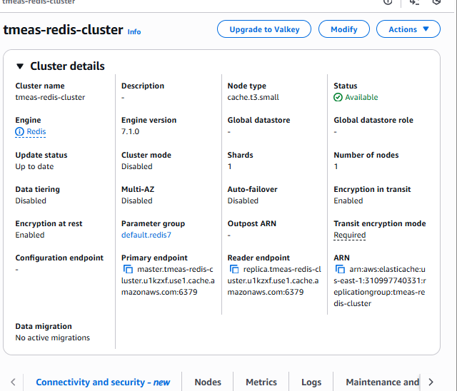
</details>

<details>
<summary><b>3.2 RDS (MySQL)</b></summary>

MySQL engine, *Dev/Test* template, micro instance class, 20 GB storage, existing VPC in the private subnet, **Public access: No** (only resources in the VPC can connect).

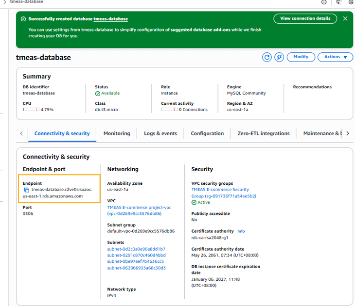
</details>

### 4. Compute: EC2

Launch **2 × Ubuntu Server 24.04 LTS, t3.micro**: one in the `us-east-1a` public subnet and one in `us-east-1b`, with *Auto-assign public IP* enabled.

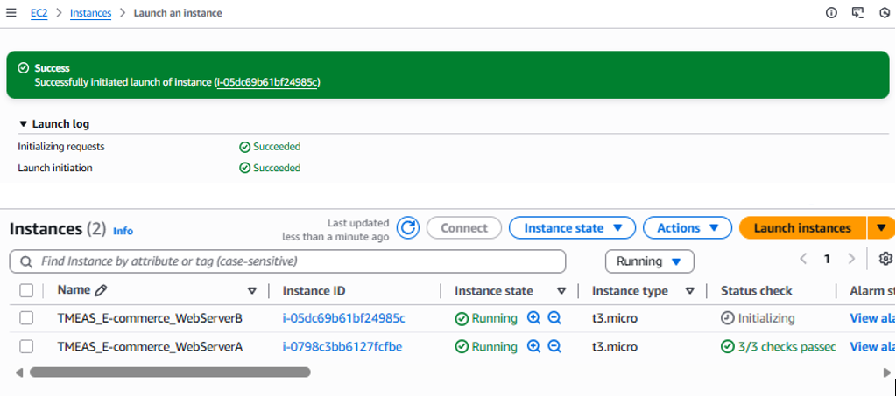

Then on **each** instance:

```bash
# 1. System packages
sudo apt update && sudo apt install -y nginx git

# 2. uv (Rust-based Python package manager)
curl -LsSf https://astral.sh/uv/install.sh | sh
source ~/.local/bin/env

# 3. Get the code (the systemd unit expects /home/ubuntu/tmeas_website)
git clone https://github.com/Elmeralex/AWS_Parallel_Distribution_System.git ~/tmeas_website
cd ~/tmeas_website
uv sync        # installs Python + Flask, Gunicorn, Authlib, PyMySQL, redis, ...
```

**Configure endpoints and secrets.** The connection values are set directly in the Python files. Replace them with your own resources:

| Setting | File(s) |
|---|---|
| Redis primary endpoint | `app.py`, `dbsetup.py` |
| RDS endpoint / user / password | `app.py`, `dbsetup.py`, `insertProducts.py` |
| Cognito `authority`, `client_id`, `client_secret`, metadata URL | `app.py` (`oauth.register`) |
| ALB DNS in `redirect_uri` and `logout_uri`, Cognito domain | `app.py` (`/login`, `/logout`) |
| Flask `secret_key` | `app.py` |
| Server label (`"Zone A"` / `"Zone B"`) | `app.py` (`index()`), set per instance so you can see load balancing |

> 💡 **Recommended:** load these from environment variables (e.g. `os.environ["RDS_PASSWORD"]`, using `Environment=` lines in the systemd unit) or AWS Secrets Manager, and never commit real credentials.

**Initialise the database** (run once from one EC2 instance, since RDS is only reachable inside the VPC):

```bash
uv run python dbsetup.py        # ⚠️ drops tables and FLUSHALLs Redis
uv run python insertProducts.py # seeds 4 products, 10 units each
```

**Nginx reverse proxy** (port 80 → Gunicorn on 127.0.0.1:8000):

```bash
sudo cp configurationfileforsetup/tmeas_website_nginx.backup /etc/nginx/sites-available/tmeas_website
sudo ln -s /etc/nginx/sites-available/tmeas_website /etc/nginx/sites-enabled/
sudo rm /etc/nginx/sites-enabled/default
sudo nginx -t && sudo systemctl restart nginx
```

**Gunicorn as a systemd service** (3 workers, auto-restart):

```bash
sudo cp configurationfileforsetup/tmeas.service.backup /etc/systemd/system/tmeas.service
sudo systemctl daemon-reload
sudo systemctl enable --now tmeas
sudo systemctl status tmeas
```

The shop is now reachable through the ALB / CloudFront URL:

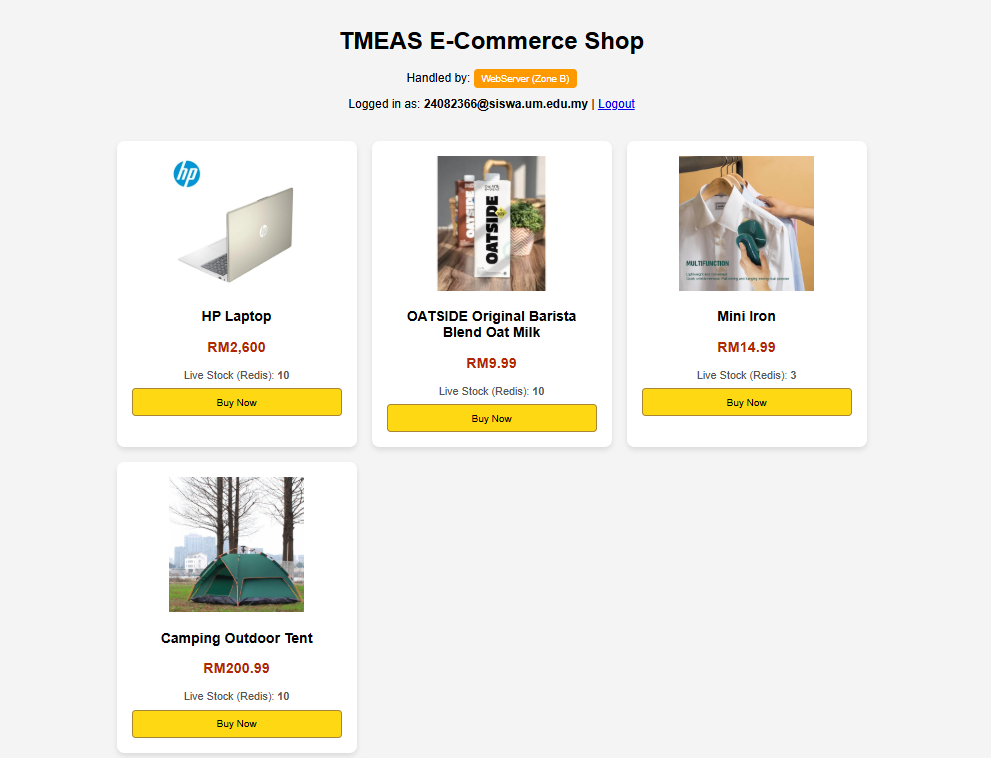

### 5. Analytics

<details>
<summary><b>5.1 AWS Glue</b>: crawler + ETL to S3</summary>

1. **Data connection** to the RDS `ecommerce` database (Amazon Aurora/MySQL type), then *Test connection*.
2. **VPC endpoint** `com.amazonaws.us-east-1.s3` (needed because there is no NAT Gateway).
3. **Crawler** → catalog database `tmeas_analytic_database`.
4. **ETL job** MySQL → S3, format **Parquet**, compression **Snappy**.

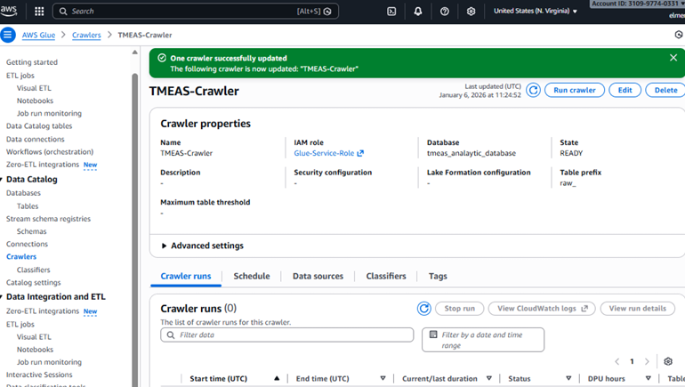
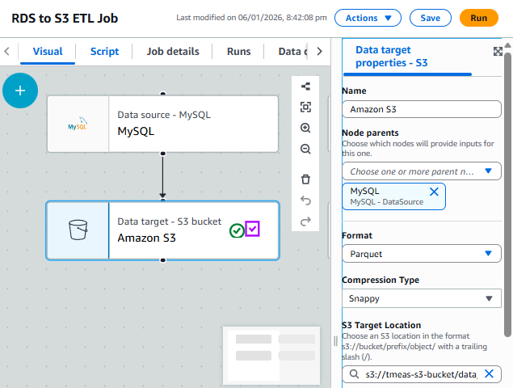
</details>

<details>
<summary><b>5.2 Amazon Athena</b></summary>

The crawled tables appear automatically in the Athena query editor via the Glue Data Catalog:

```sql
SELECT * FROM orders;
SELECT product_id, COUNT(*) AS orders FROM orders GROUP BY product_id;
```

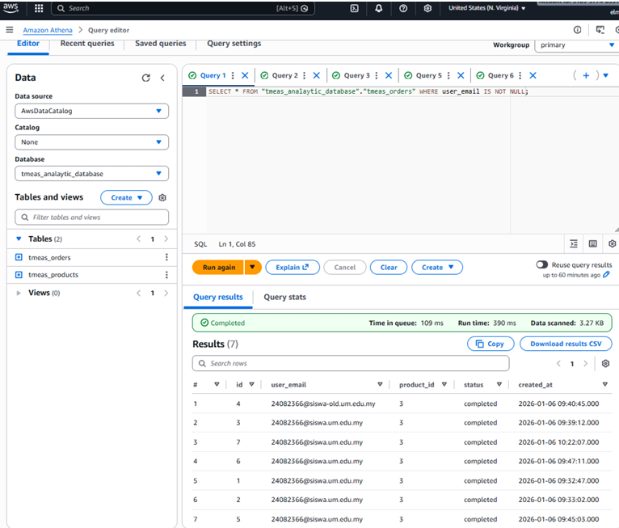
</details>

<details>
<summary><b>5.3 Amazon QuickSight</b></summary>

Connect QuickSight to Athena / the AWS Data Catalog, select `tmeas_analytic_database`, and build dashboards (e.g. order count per product).

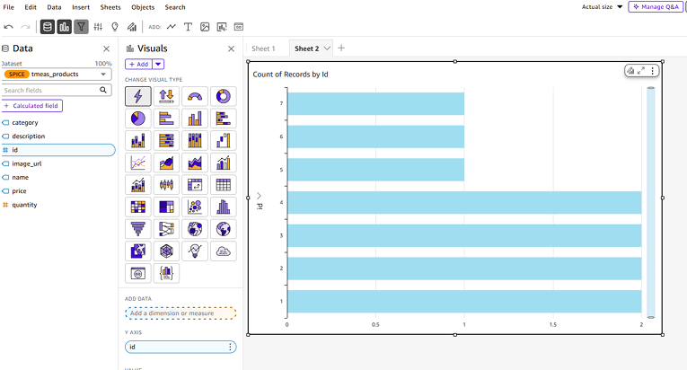
</details>

---

## Testing

### Functional checks

| Test | Steps | Expected |
|---|---|---|
| Auth enforced | Open the ALB/CloudFront URL in a private window | Redirected to Cognito sign-in |
| Login | Sign in with a Cognito user | Shop page shows *Logged in as &lt;email&gt;* |
| Load balancing | Refresh the shop page several times | *Handled by* badge alternates between Zone A / Zone B |
| Purchase | Click **Buy Now** | Redirect to *Order Confirmed*, stock decreases by 1 |
| Oversell protection | Buy a product until stock hits 0 | Button disables; extra POSTs return *Out of Stock* |
| Consistency | Compare Redis vs RDS (below) | Redis stock = RDS `quantity`; order count matches units sold |

```bash
# Redis live stock (from an EC2 instance)
redis-cli --tls -h <redis-endpoint> -p 6379 GET stock:1
```
```sql
-- RDS
SELECT id, name, quantity FROM products;
SELECT product_id, COUNT(*) FROM orders GROUP BY product_id;
```

### Load test with Locust

The stress test simulated **500 concurrent users** against the ALB. Example `locustfile.py` matching the endpoints tested:

```python
from locust import HttpUser, task, between

class Shopper(HttpUser):
    wait_time = between(1, 3)

    @task(3)
    def browse(self):
        self.client.get("/")

    @task(1)
    def login(self):
        self.client.get("/login")
```

```bash
pip install locust
locust -f locustfile.py --host https://<ALB-DNS>
# open http://localhost:8089, set 500 users, start
```

Watch the results in **CloudWatch**: ALB (`RequestCount`, `ActiveConnectionCount`, `TargetResponseTime`), EC2 (`CPUUtilization`, `StatusCheckFailed`), ElastiCache (`CPUUtilization`, `CacheHits`, `Evictions`) and RDS (`CPUUtilization`, `WriteLatency`).

---

## Performance Results

### Locust (500 users)

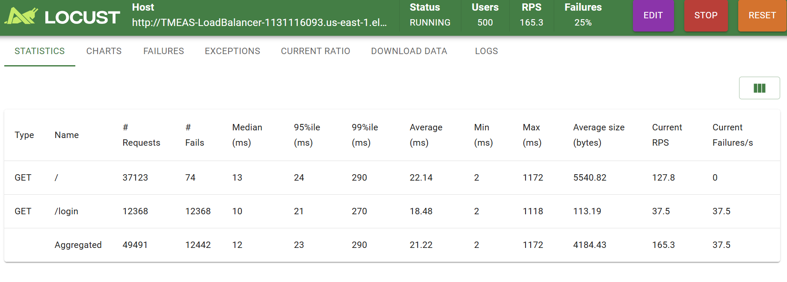

| Endpoint | Requests | Fails | Median | 95%ile | Avg |
|---|---|---|---|---|---|
| `GET /` | 37,123 | 74 (0.2%) | 13 ms | 24 ms | 22.1 ms |
| `GET /login` | 12,368 | 12,368 | 10 ms | 21 ms | 18.5 ms |
| **Aggregated** | **49,491** | 12,442 | **12 ms** | **23 ms** | **21.2 ms** |

Peak throughput was **≈165 RPS**. The `/login` "failures" are the expected Cognito OIDC redirect, which the load generator does not complete. The actual shop page (`/`) succeeded **99.8%** of the time.

### Application Load Balancer

| Active connections | Request count | Target response time |
|---|---|---|
| 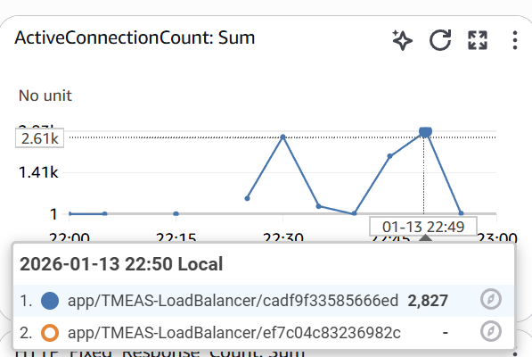 | 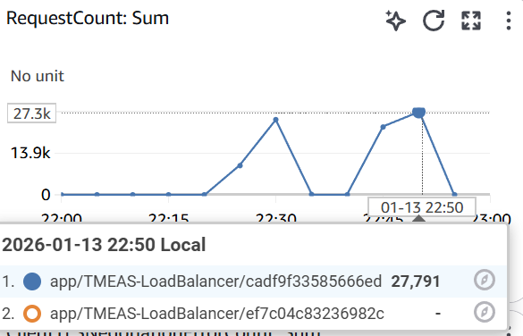 | 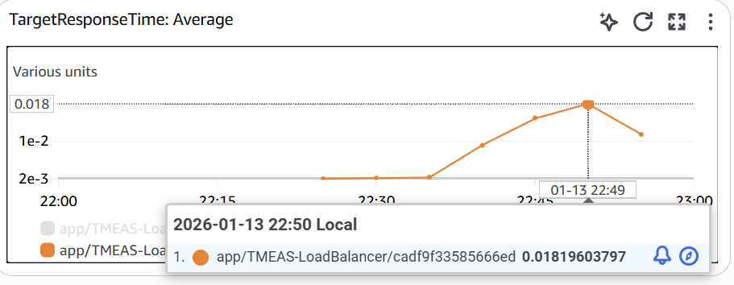 |
| **2,827** at peak | **27,791** requests | **~18 ms** |

### EC2 web servers

| CPU utilisation | Status check failed |
|---|---|
| 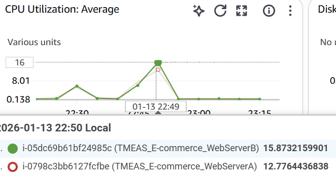 | 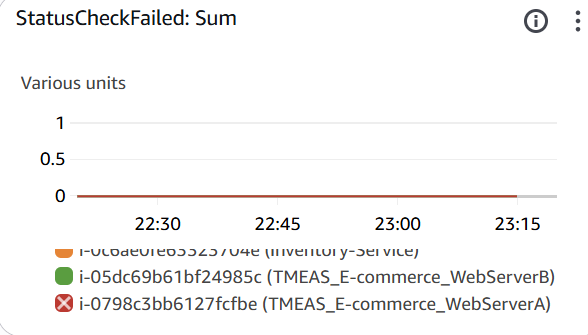 |
| Server A ≈ 12.8%, Server B ≈ 15.9%, spiking **together** (even load distribution) | **0** (no instance crashed) |

### Data tier

| Redis evictions | Redis CPU | RDS CPU | RDS write latency |
|---|---|---|---|
| 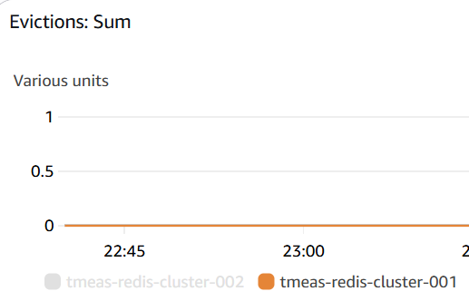 | 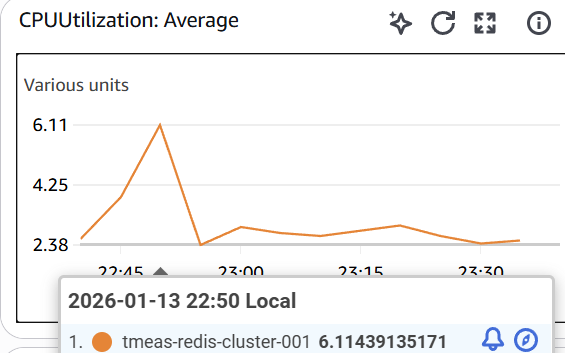 | 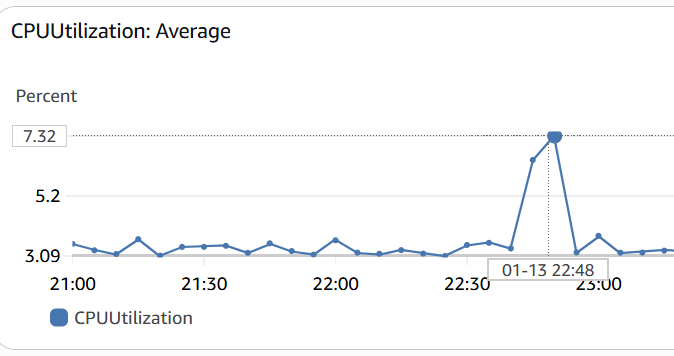 | 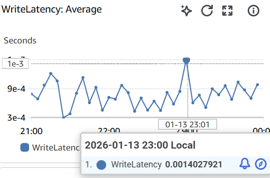 |
| **0** | **6.11%** peak (~193k cache hits) | **7.32%** peak | **~1 ms** |

**Takeaway:** under a 500-user spike, every tier stayed far below saturation. The ALB kept response times around 18 ms, both instances shared the load evenly, and Redis/RDS used under 8% CPU, which leaves plenty of headroom for horizontal scaling.

---

## Limitations & Future Work

**Limitations**
- Built within AWS Learner Lab / free-tier quotas: only 2 low-tier EC2 instances, no Auto Scaling group, no NAT Gateway.
- Security group kept open for demo simplicity; credentials are set in source.
- Assumes users stay logged in and only browse/purchase (no inventory admin or cart).

**Future work**
- EC2 **Auto Scaling** behind the ALB for elastic capacity.
- **Event-driven** order processing with AWS Lambda / SQS (async inventory updates, notifications, analytics triggers).
- Move secrets to **AWS Secrets Manager** and use least-privilege security groups.
- Multi-AZ RDS and a Redis replica for higher availability.

---

## License

Licensed under the [Apache License 2.0](LICENSE).
